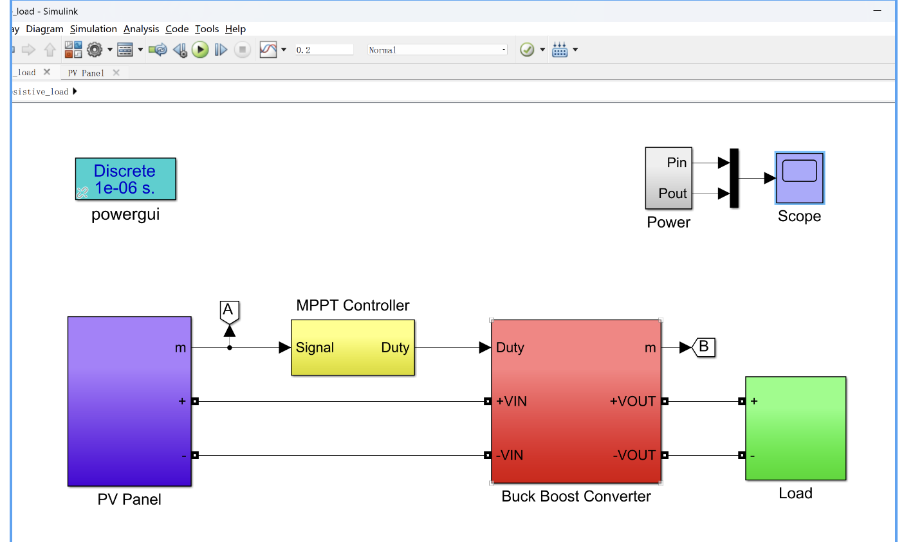

# Solar Maximum Power Point Tracking Technology using Resistive Loads, with a solar MPPT device equipped with a step-up/down converter to track the maximum power point of solar cells.

The solar maximum power point tracking technology using a resistive load, and the solar MPPT device with a step-up/down converter to track the maximum power point of the solar cell (Simulation in Simulink).
​  
\n        \n  

## Images

<!-- PAYMENT_BLOCK -->

## Get this dataset

- Payment link (Stripe): [Buy now](https://buy.stripe.com/3cs8yP7sY87d0vu9AB)
- Payment QR code: 

<!-- /PAYMENT_BLOCK -->
